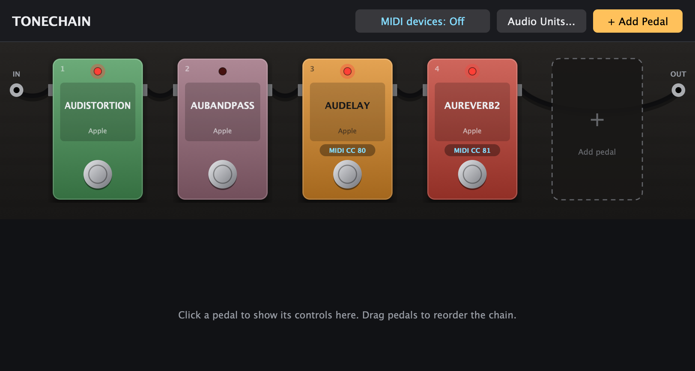

# Tonechain

**A pedalboard for your Audio Units.** Load any AU effect as a stompbox, chain them with virtual patch cables, stomp them on and off with a MIDI footswitch, and save the whole rig with your Logic Pro project.



## Features

- **Any AU effect becomes a pedal.** Amp sims, drives, delays, reverbs: anything installed on your Mac.
- **Drag to reorder.** Pick up a pedal and drop it anywhere in the chain; the other pedals slide aside as you drag.
- **True bypass footswitches.** A bypassed pedal is wired around the chain and switched into its own bypass mode to save CPU.
- **MIDI footswitch control.** Right-click a pedal → *MIDI Learn*, press a switch on your controller, done. Works straight from your MIDI devices, so there's nothing to route in Logic.
- **Pedal UIs right below the board.** Click a pedal to edit it. UIs too big for your screen open in their own window.
- **Everything saves with your project:** pedal order, on/off states, MIDI assignments and every pedal's settings.
- Runs as an **Audio Unit** in Logic Pro (and other AU hosts) or as a **standalone app**.
- Universal binary for Apple Silicon and Intel Macs, macOS 11 or later.

## Install

1. Download the latest `Tonechain-x.y.z-macOS.zip` from [Releases](https://github.com/AsifSyeed/tonechain/releases) and unzip it.
2. Copy `Tonechain.component` to `~/Library/Audio/Plug-Ins/Components/`
   (in Finder: **Go → Go to Folder…** and paste that path).
3. Tonechain isn't signed by Apple yet, so macOS blocks it until you run this once in Terminal:
   ```sh
   xattr -dr com.apple.quarantine ~/Library/Audio/Plug-Ins/Components/Tonechain.component
   ```
4. Restart Logic Pro. Tonechain is under **Audio FX → Audio Units → Asif Syeed → Tonechain**.

If Logic doesn't list it, open **Logic Pro → Settings → Plug-in Manager**, select Tonechain and click **Reset & Rescan Selection**.

For the standalone app, move `Tonechain.app` to `/Applications` and run
`xattr -dr com.apple.quarantine /Applications/Tonechain.app`.

## Using Tonechain

| To… | Do this |
|---|---|
| Find your plug-ins (first time) | **Audio Units…** → Options → *Scan for new or updated AudioUnit plug-ins* |
| Add a pedal | **+ Add Pedal**, or click the dashed slot at the end of the board |
| Edit a pedal | Click it; its controls appear below the board |
| Turn a pedal on/off | Click its footswitch (LED lit = on) |
| Reorder | Drag a pedal left or right, or right-click → *Move Left / Move Right* |
| Remove | Hover and click **×**, or right-click → *Remove from board* |
| Assign a MIDI footswitch | Right-click → *MIDI Learn…*, then press the switch |
| Choose which MIDI devices it listens to | The **MIDI** button in the header |

### MIDI switch behaviour

Right-click a pedal with a MIDI assignment → *MIDI switch behaviour*:

- **Toggle on each press** (default): for momentary footswitches. Every press flips the pedal.
- **Follow switch**: for latching footswitches that send 127 for on and 0 for off. Keeps your controller's LEDs in sync with the pedals.

One footswitch can switch several pedals: learn the same switch on each of them.

## Build from source

Requires Xcode and CMake 3.22 or later. JUCE is downloaded automatically (or set `JUCE_SOURCE_DIR` to use your own checkout).

```sh
git clone https://github.com/AsifSyeed/tonechain.git
cd tonechain
cmake -B build -G Xcode
cmake --build build --config Release --target Tonechain_AU Tonechain_Standalone
```

The AU is copied to `~/Library/Audio/Plug-Ins/Components/` automatically. `./scripts/package.sh` builds a universal release zip in `dist/`.

## Known limitations

- Hosts Audio Units only (no VST3).
- The chain is serial; no parallel or wet/dry splits yet.
- A pedal that crashes takes its host down with it, as with any plug-in.
- When a stereo pedal feeds a mono-only pedal, only the left channel passes through.

## License

Tonechain is free software, licensed under the [GNU Affero General Public License v3.0](LICENSE).

Built with [JUCE](https://juce.com), used under its AGPLv3 license.
